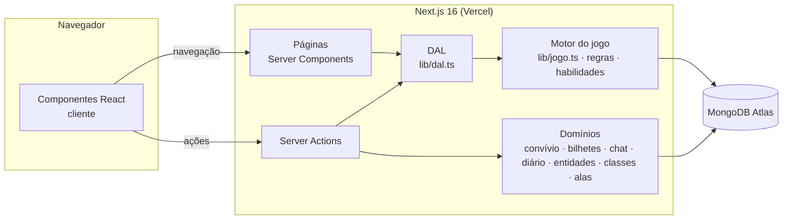

<p align="center">
  
</p>

<h1 align="center">Hospital Marito</h1>

<p align="center"><em>Sistema de Registro e Avaliação de Pacientes</em></p>

<p align="center">
  <a href="https://marito-steel.vercel.app/login"><strong>▶ Jogar no navegador</strong></a>
</p>

---

Você acorda no Dormitório com uma pulseira e um número: o seu **prontuário**. O sistema do Hospital de Saúde Mental Marito registra tudo o que você faz, avalia seus atributos e decide quais portas se abrem. As ordens de atividade continuam correndo mesmo com o sistema fechado. A equipe anota na sua ficha. Os outros internos mandam bilhetes que somem em um dia.

E às 03:17, todas as noites, alguém consulta o seu prontuário.

**Hospital Marito** é um RPG idle de navegador, feito para celular, com terror psicológico sutil e a estética de um prontuário datilografado em papel velho: carimbos, tarjas pretas, anotações à caneta azul e um paciente de número **0112** que não tem internação registrada. Um **Mestre** conduz a história pelo painel da coordenação, como numa mesa de RPG.

<!-- Galeria de telas: descomentar quando as capturas estiverem em docs/imagens/ (ficha, missoes, atributos, diario, entidades, coordenacao .png)
## Telas

<table>
  <tr>
    <td align="center"><br /><sub>Ficha do paciente</sub></td>
    <td align="center"><br /><sub>Ordens de atividade</sub></td>
    <td align="center"><br /><sub>Atributos e habilidades</sub></td>
  </tr>
  <tr>
    <td align="center"><br /><sub>Diário encontrado</sub></td>
    <td align="center"><br /><sub>Entidades e Lua Negra</sub></td>
    <td align="center"><br /><sub>Painel da coordenação</sub></td>
  </tr>
</table>
-->

## Sumário

- [O jogo](#o-jogo)
- [A história (contém spoilers)](#a-história-contém-spoilers)
- [Funcionalidades](#funcionalidades)
- [Arquitetura](#arquitetura)
- [Estrutura de pastas](#estrutura-de-pastas)
- [Dados (MongoDB)](#dados-mongodb)
- [Regras do jogo](#regras-do-jogo)
- [Tecnologias](#tecnologias)
- [Segurança](#segurança)
- [Rodar no computador](#rodar-no-computador)
- [Publicar na Vercel](#publicar-na-vercel)
- [Design e documentação](#design-e-documentação)
- [Limitações conhecidas e próximos passos](#limitações-conhecidas-e-próximos-passos)
- [Créditos](#créditos)
- [Licença](#licença)

---

## O jogo

Inspirado em idles como *Melvor Idle*: o paciente cumpre **ordens de atividade** que continuam correndo com o jogo fechado, ganha XP, sobe de nível, distribui pontos em atributos e desbloqueia áreas do hospital. Por baixo da progressão corre uma narrativa: o 0112 fala no chat a cada duas horas, escreve no histórico às 03:17, deixa bilhetes e aparece num diário de 1974.

**Dois perfis:**

| Perfil | Quem é | O que faz |
| --- | --- | --- |
| **Paciente** | O jogador | Faz cadastro, cumpre missões, evolui, convive com outros pacientes, coleciona páginas e entidades |
| **Coordenação (Mestre)** | Quem conduz o jogo | Cria missões, libera áreas, reclassifica pacientes, escreve anotações, edita textos da história, entrega itens |

As contas da coordenação são criadas só por script (`npm run db:equipe`), nunca pelo cadastro.

## A história (contém spoilers)

> Para quem vai desenvolver ou conduzir o jogo como Mestre. Jogadores: parem aqui.

<details>
<summary><strong>Abrir os segredos do hospital</strong></summary>

- **O Programa de Avaliação Contínua (1974).** O Marito começou a medir atributos dos internos em fichas. Os primeiros classificados como **ANÔMALOS** foram transferidos à noite para o andar de baixo, sem aviso às famílias (Memorial).
- **O 0112.** Não há internação registrada com esse número, mas ele está em toda parte: fala no chat a cada duas horas (01:12, 03:12…), escreve no histórico às 03:17, prevê o dia de amanhã, pede convívio todos os dias e deixa bilhetes. O quarto 112 "está vazio desde 1998".
- **A Ala Zero.** Área secreta (nível 8) que não consta na planta oficial. O nome aparece letra a letra a partir do nível 6; com Vínculo 10 aparece inteiro.
- **O diário da enfermeira C.** Doze páginas de 1974, achadas em ordem pelas áreas: a prancheta de seis colunas, os 31 leitos numa lista de 30, a bandeja do 112, a escada que guarda um degrau, os primeiros ANÔMALOS. Na página 09 (Capela) a letra muda: *"não fui eu que escrevi a página anterior"*. Na 12, C. pede transferência para a Ala Zero.
- **A última entrada.** Ao juntar as 12 páginas: *"O quarto 112 ficou vazio em 1998. Eu não."* **C. é o 0112.**
- **Os segredos de Vínculo.** VIN 5 tira a tarja do nome do 0112 no chat; VIN 10 mostra a Ala Zero na planta; VIN 15 deixa ler a anotação de amanhã na ficha: *"Paciente transferido para a Ala Zero. Leito já preparado. Família não será informada."*
- **As entidades.** A Lua Negra chama presenças do hospital; a lendária é *Aquilo que mora no 112*.
- **Detalhes que o Mestre pode usar:** a ordem OS-019 que ninguém autorizou, a sugestão de amizade "Sugerido por: ██████", a lista de pacientes que mostra um a mais, a Capela interditada que trava o diário até ser aberta.

</details>

## Funcionalidades

### Paciente

| Tela | O que tem |
| --- | --- |
| **Ficha** | Identificação, foto (10 figurinhas pintadas), carimbo da classe, diagnóstico, relato editável, anotações da equipe, entidade que acompanha |
| **Atributos** | 6 atributos (FOR, AGI, VIT, CON, VIN, SOR) com **habilidades**: efeitos por ponto, marcos a cada 5 pontos e automações (repetir missão, fila de 3 ordens, distribuição automática de pontos) |
| **Missões** | Ordens por nível e por área, cronômetro que continua offline, fila, repetição, aviso de página do diário e de Lua Negra |
| **Alas** | Planta do hospital com 10 áreas (uma secreta), primeira visita vale XP |
| **Convívio** | Amizades por pedido e aceite, busca por nome, sugestões (inclusive uma estranha por dia), ficha do amigo, **bilhetes** (2 por dia, somem em 24 h) |
| **Chat** | Canal geral que apaga em 24 h; o 0112 fala a cada 2 horas |
| **Histórico** | Livro de ocorrências por dia, com repetições agrupadas (×N), anotações do 0112 e uma "previsão de amanhã" |
| **Diário** | 12 páginas de 1974 achadas em ordem nas missões (1% por ordem) + uma última entrada |
| **Entidades** | Lua Negra (1% por ordem) invoca entidades colecionáveis; uma delas acompanha a ficha |
| **Avisos** | "Enquanto você esteve fora": resumo ao vivo em todas as telas |
| **Tutorial e Memorial** | Como jogar e a história do sanatório |

### Coordenação

| Tela | O que tem |
| --- | --- |
| **Missões** | Criar, editar, publicar, arquivar; nível mínimo, área, XP e duração (10 s a 24 h) |
| **Pacientes** | Atributos, relato, histórico, diagnóstico, anotações da equipe e reclassificação |
| **Alas** | Nível e interdição de cada área, com a planta |
| **Classes** | Catálogo de classes: nome, descrição, cor do carimbo, figurinha sugerida |
| **Diário** | Editar data, área, texto e caligrafia das páginas |
| **Entidades** | Entregar Luas Negras, editar nome e descrição das entidades |
| **Chat** | Falar como coordenação ou como aviso do sistema |

## Arquitetura

O servidor é a única fonte da verdade: o navegador nunca decide XP, sorteios ou conclusões. Toda regra roda no servidor e o navegador só desenha e chama ações.



**Princípios**

- **Servidor autoritativo.** As missões guardam só o horário de início; ao abrir uma tela, `calcularPendencias` resolve tudo o que aconteceu desde o último acesso (conclusões, repetições, fila, drops, bônus diário), até o teto offline.
- **Concorrência otimista.** Toda mudança de jogo passa por `mutarPaciente`, que grava só se o campo `versao` não mudou e tenta de novo em caso de conflito (várias abas, ações simultâneas).
- **Camada de acesso (DAL).** Páginas e ações protegidas passam por `pacienteAtual`, `prontuarioDaSessao` e `coordenadorDaSessao`; nada confia no que vem do navegador.
- **Arquivos `*-base.ts`.** Tipos, textos e regras puras (sem banco) ficam separados para poderem ir ao navegador; os arquivos sem `-base` acessam o MongoDB e nunca são importados por componentes de cliente.
- **Migrações únicas.** Mudanças de modelo rodam uma vez por processo (`umaVez`) e deixam uma marca na coleção `contadores`.
- **Dados temporários com TTL.** Chat e bilhetes expiram em 24 h e avisos de área em 14 dias, apagados pelo próprio MongoDB.
- **Economia de requisições.** Com "Repetir" ligado, a tela conta os ciclos e o servidor registra a cada 90 s; com a aba escondida nada é chamado; as respostas trazem o estado novo e a página só recarrega quando precisa.
- **Narrativa determinística.** Falas e anotações do 0112 são escolhidas por data e prontuário, sem tarefas agendadas.

## Estrutura de pastas

```
app/
  (acesso)/        login e cadastro (3 etapas)
  (paciente)/      ficha, atributos, missões, alas, convívio (+ bilhetes), chat,
                   histórico, diário, entidades — e actions.ts com as ações do paciente
  coordenacao/     missões (+ editor), pacientes, alas, classes, diário, entidades, chat
  memorial/ tutorial/
  chat-actions.ts  ações do canal geral (paciente e coordenação)
  globals.css      tokens visuais, papel velho, animações (com "reduzir movimento")
  icon.svg         selo do hospital (ícone da aba)
components/        cabeçalho, navegação, avisos, figurinhas, entidades, chat, ui
lib/
  db.ts            conexão MongoDB (cliente único, preguiçoso)
  sessao.ts dal.ts equipe.ts limite.ts     sessão, acesso, coordenação, limite de tentativas
  jogo.ts regras.ts habilidades.ts         motor: XP, níveis, pendências, automações
  pacientes.ts atributos.ts ordens.ts alas.ts planta.ts
  convivio.ts bilhetes.ts chat.ts avisos.ts historico.ts livro.ts
  classes*.ts diario*.ts entidades*.ts     catálogos editáveis pelo Mestre
scripts/           testar, semear, criar/remover equipe, resetar banco
docs/              missões no banco, prompt de animações
```

## Dados (MongoDB)

| Coleção | Guarda |
| --- | --- |
| `pacientes` | Ficha, progresso, atributos, missão em curso, fila, automações, páginas, luas, entidades |
| `ordens` | Missões criadas pela coordenação |
| `historico` | Livro de ocorrências de cada paciente |
| `alas` | Nível e situação de cada área |
| `convivio` | Pedidos e vínculos entre pacientes |
| `bilhetes` | Bilhetes entre pacientes (TTL 24 h) |
| `mensagens` | Chat geral (TTL 24 h) |
| `avisos_areas` | Mudanças nas áreas para os avisos (TTL 14 dias) |
| `sugestoes_dispensadas` | Sugestões de convívio que o paciente dispensou |
| `classes` | Catálogo de classes |
| `diario` | Páginas do diário editadas pelo Mestre (só as alteradas) |
| `entidades` | Nome e descrição editados das entidades (só as alteradas) |
| `equipe` | Contas da coordenação |
| `tentativas` | Limite de tentativas de login e envio |
| `contadores` | Sequências e marcas de migração |

## Regras do jogo

| Regra | Valor |
| --- | --- |
| XP para o próximo nível | 1.000 × 1,5^(nível − 1) |
| Pontos por nível | 3 (novo paciente começa com 1 em cada atributo e 3 pontos) |
| Bônus | +50 XP de acesso diário · +200 XP na primeira visita a cada área |
| Missões | Uma por vez, sem limite diário, 10 s a 24 h, mínimo de 5 s com AGI |
| FOR · Turno pesado | +1% XP por ponto em missões de 1 h ou mais |
| AGI · Passos leves | −1% de duração por ponto (até −40%); 10 = repetir missão |
| VIT · Resistência | Teto offline 8 h + 30 min a cada 5 pontos; 10 = fila de 3 ordens |
| CON · Prontuário em dia | +0,5% XP por ponto; 10 = distribuição automática de pontos |
| VIN · Escuta | Segredos em 5, 10 e 15 |
| SOR · Acaso | 0,5% por ponto de a missão contar duas vezes |
| Diário | Página seguinte, na área dela, 1% por ordem concluída |
| Lua Negra | 1% por ordem concluída; entidades com pesos 20/20/20/14/14/5/5/1 |

As decisões completas estão no documento de decisões do projeto.

## Tecnologias

| Camada | Tecnologia |
| --- | --- |
| Framework | **Next.js 16** (App Router, Server Components, Server Actions, `cacheComponents`, Turbopack) |
| Interface | **React 19**, **Tailwind CSS 4**, fontes Special Elite, Courier Prime, Caveat e Homemade Apple (`next/font`) |
| Linguagem | **TypeScript 5** |
| Banco | **MongoDB Atlas** com o driver oficial `mongodb` 7 |
| Sessão | Cookie `httpOnly` com JWT assinado (`jose`, HS256) |
| Senhas | `bcryptjs` |
| Qualidade | ESLint 9 (`eslint-config-next`) |
| Hospedagem | **Vercel** (região `gru1`) + Atlas em São Paulo (`sa-east-1`) |
| Arte | Figurinhas e entidades em SVG gerado por código; selo em SVG |
| Design | Claude Design (canvas com todas as telas antes do código) |

## Segurança

- Senhas com bcrypt; o login compara com um hash falso quando o prontuário não existe, para não revelar quais existem.
- Sessão em cookie `httpOnly`, `sameSite=lax`, `secure` em produção: 7 dias para pacientes, 12 horas para a coordenação (invalidada se a conta mudar).
- Limite de tentativas por IP e por conta (`lib/limite.ts`).
- Toda entrada de ação é validada no servidor; sorteios e recompensas só no servidor.
- O navegador nunca recebe o que o paciente ainda não desbloqueou (texto de páginas não achadas, entidades não invocadas).
- O Mestre não lê os bilhetes entre pacientes.

## Rodar no computador

Requisitos: Node.js 20.6 ou mais novo e um cluster no MongoDB Atlas.

### Variáveis de ambiente (`.env.local`)

| Variável | Obrigatória | Para que serve |
| --- | --- | --- |
| `MONGODB_URI` | Sim | Endereço do cluster no Atlas (sem nome de banco no fim). |
| `SESSION_SECRET` | Sim | Assina as sessões. Mínimo 32 caracteres, aleatória. |
| `MONGODB_DB` | Não | Nome do banco. Padrão `marito`. Use `marito_dev` no computador para não mexer nos dados do jogo publicado. |

Gerar um segredo novo:

```bash
node -e "console.log(require('crypto').randomBytes(32).toString('base64url'))"
```

### Comandos

```bash
npm install
npm run db:testar     # testa a conexão
npm run db:semear     # missões de exemplo
npm run db:equipe     # conta da coordenação
npm run dev           # http://localhost:3000
```

| Script | O que faz |
| --- | --- |
| `npm run dev` / `build` / `start` | Desenvolvimento, build e produção local |
| `npm run lint` | ESLint |
| `npm run db:testar` | Testa a conexão e conta os documentos |
| `npm run db:semear` | Cria as missões de exemplo |
| `npm run db:equipe` / `db:equipe:remover` | Cria ou remove uma conta da coordenação |
| `npm run db:resetar` / `db:resetar:tudo` | Apaga o progresso dos pacientes / apaga tudo |

Os comandos `db:*` leem o `.env.local`. Para rodar um deles contra outro banco, troque `MONGODB_DB` no `.env.local`.

## Publicar na Vercel

1. **Atlas › Database & Network Access › IP Access List:** adicione `0.0.0.0/0` (a Vercel não tem IP fixo no plano gratuito). Use um usuário do banco com senha forte e permissão só de leitura e escrita.
2. **Vercel › Add New › Project:** importe o repositório `aristoph-ubrain/Marito`. O framework (Next.js) é detectado sozinho; não mude os comandos de build.
3. **Environment Variables:** `MONGODB_URI` e `SESSION_SECRET` (um segredo novo, diferente do local). `MONGODB_DB` só se quiser um banco diferente de `marito`.
4. **Deploy.** Depois, em Settings › Functions › Function Region, escolha a região mais perto do cluster do Atlas (São Paulo = `gru1`, se o cluster estiver em `sa-east-1`).
5. Prepare o banco de produção do seu computador, com o `.env.local` apontando para ele: `npm run db:semear` e `npm run db:equipe`.

Cada `git push` na branch `main` publica de novo sozinho.

## Design e documentação

- **Canvas de design:** todas as telas (paciente, coordenação, acesso, figurinhas, ícones) são desenhadas primeiro num canvas do Claude Design e só depois implementadas.
- **`docs/prompt-animacoes.md`:** direção das animações (papel, máquina de escrever, terror sutil, "reduzir movimento").
- **`docs/missoes-no-banco.md`:** como as missões ficam no banco.
- **Decisões do MVP:** documento com cada regra e o motivo dela.

## Limitações conhecidas e próximos passos

- **Sem tempo real:** chat, avisos e missões usam consultas periódicas (a Vercel Hobby não mantém WebSocket).
- **Sem notificação no celular:** o próximo passo natural é virar app instalável (PWA) com aviso de missão concluída.
- **Sem testes automatizados** do motor (fila, repetição, teto offline, sorteios).
- **Classes e entidades são só narrativa/coleção**, sem efeito de jogo por enquanto.
- **Arte em SVG gerado por código**; ilustração e som de verdade ficam para uma fase de atmosfera.

## Créditos

- **Criação, direção e Mestre:** Aristoph Ubrain, engenheiro de software
- **Desenvolvimento:** feito com o Claude (Anthropic), do canvas de design ao código, sob a direção do autor.
- **Fontes:** Special Elite, Courier Prime, Caveat e Homemade Apple (Google Fonts, licença SIL Open Font).
- **Arte:** figurinhas, entidades e selo desenhados em SVG para o jogo. Nenhum personagem de outras obras.

## Licença

© 2026 Aristoph Ubrain. **Todos os direitos reservados.**

O código, os textos, a narrativa e a arte deste repositório não podem ser copiados, modificados, distribuídos ou usados em outros projetos sem autorização por escrito do autor.

